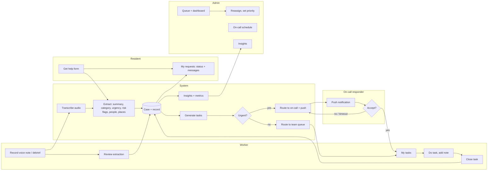

# App flow and mockups

Where the app is going after the Nov 21 reset (the app was cut back to the
landing page, sign-in and account; the old prototype is on the
`archive/full-prototype` branch). This page is the plan we build from, one
step at a time.

**Figma:** [Hacksgiving 2027](https://www.figma.com/design/5nncReT4jVQR4P83fm7Dpz/Hacksgiving-2027)

- Page **App flow**: the pipeline, a lane per person, build order, screens, data, open questions.
- Page **Mockups**: phone screens for the four main user flows (below).

The mockups are visual sketches with sample data, not a spec: names,
addresses, numbers and "Harbor House" are made up.

## What we're building, in one line

Information comes in (a resident's request or a worker's recorded debrief),
the AI turns it into a case with tasks, urgent work goes to whoever is on
call, and everything feeds insights for staff.

The four ideas from the proposals map onto it like this:

| Idea | Where it lives |
|---|---|
| Information goes into a database, tasks get generated automatically | Step 1: capture → store → generate tasks |
| Coordinate responses: AI routing + push notifications (on call vs not) | Step 2: route + notify |
| "Phantom" for DV + insights + metrics | Step 3: record → transcribe → extract, and insights |
| Training + org information, shared with authorities as needed | Step 4 |

"Phantom" is an internal app from Austin's job: record standups and AI
extracts insights (built for senior living). We borrow the pattern: a worker
talks through what happened instead of filling in a form.

## Mockups: the four user flows

### 1. A resident asks for help
Home → Get help form → Request received → My request.

- Home leads with **Get help now** and a "Call 911 first if you're in danger" card.
- The form asks what's going on, where, how to reach them, and whether it's
  safe to call or leave a voicemail (safe-contact matters for DV).
- After sending: a reference number and what happens next.
- My request shows only what staff chose to share (status, messages);
  internal notes stay private.
- A red **Quick exit** button is on every resident screen.

### 2. A worker records a debrief (the Phantom pattern)
My tasks → Recording → Review before saving → Case.

- My tasks: generated tasks by due time, an **On call** badge, and a big
  **Record a debrief** button.
- Recording: a timer and a waveform, and a note that the audio is deleted
  after transcription and names are removed before the AI reads it.
- Review: the AI's summary, category, urgency, risk flags and location, and
  the tasks it will create. The worker fixes anything wrong, then saves.
- Case: tasks, history and referrals in one place.

### 3. An urgent request reaches whoever is on call
Lock-screen push → Respond → En route.

- Push: "Urgent", the AI's one-line summary, tap to respond.
- Respond: map, what we know, distance, a countdown before it moves to the
  next on-call worker, **Accept** or **Pass**.
- En route: ETA, an arrival checklist, **Call 911** and **I've arrived**.

### 4. Staff run the operation
Dashboard → Insights.

- Dashboard: active, new, urgent and unassigned counts; who's on call now;
  what needs attention.
- Insights: average response time, cases resolved, requests by need, and
  spotted patterns (e.g. repeat calls at one intersection on weekend nights).

## The pipeline

The whole app as one pipeline. Build it left to right, one slice at a time;
each slice is usable on its own. Status: **have** = exists in the API or app
today, **new** = to build.

```
capture  →  extract  →  store  →  generate tasks  →  route + notify  →  work  →  close  →  insights
```

## People

| Who | Uses the app to |
|---|---|
| **Resident** | Ask for help, follow their request |
| **Field worker** | Record what happened, work their tasks |
| **On-call responder** | Get pushed urgent tasks, accept or hand off |
| **Staff admin** | Run the queue, manage people, on-call and training |
| **Partner / authority** | Receive what's shared with them (referrals, reports) |

## The main flow (one lane per person)



## Steps, in build order

### 1. Capture → store → tasks (the spine)
- **Capture** (new screens): resident "Get help" form; worker "New record" with text first, voice next.
- **Extract** (have: AI routing to a service + urgency; new: tasks and risk flags).
- **Store** (have: `cases`, `case_updates`; new: `tasks` table: case, title, status, assignee, due).
- **Generate tasks** (new): one function, `generate_tasks(case)`. Rules per category first, AI later.
- **Done when:** a resident submits, tasks appear for staff, a worker closes them, the resident sees the update.

### 2. Coordinate responses
- On-call status per worker (new: `on_call` shifts or a toggle).
- Push notifications (new: Expo push tokens per device, a sender in the API).
- Routing rule: urgent → current on-call, with escalation if not accepted in N minutes; else → team queue.
- Info sharing: tasks and notes visible to whoever is assigned; a handoff note when reassigned.

### 3. Phantom-style capture + insights (domestic violence focus)
- Record a debrief → transcribe → extract (the Phantom pattern), feeding step 1's spine.
- Domestic-violence safeguards: no audio kept after transcription, names stripped before the AI sees text,
  DV cases staff-only, a quick-exit button on resident screens.
- Insights: trends across records (by category, neighborhood, time; repeat addresses; response time).

### 4. Training + org information, shared with authorities
- Training modules and completion per worker (old prototype on `archive/full-prototype`).
- Org info: partners, contacts, policies.
- Sharing: an explicit "share with" action on a case (partner or authority), with what's shared logged.

## Screens

| Screen | Who | Step | Status |
|---|---|---|---|
| Landing | everyone | 0 | have |
| Sign in / Account | everyone | 0 | have |
| Get help (form) | resident | 1 | have (`/help`, works signed out) |
| Request received | resident | 1 | have (`/help/received`) |
| My requests / My request | resident | 1 | have (`/help/requests`, `/help/request/[id]`) |
| New record (text, then voice) | worker | 1 / 3 | new |
| Review extraction | worker | 3 | new |
| My tasks | worker | 1 | new |
| Queue + dashboard | admin | 1 | new (API have) |
| Case detail (history, tasks) | staff | 1 | new (API have) |
| On-call toggle / schedule | worker, admin | 2 | new |
| Push → accept / hand off | on-call | 2 | new |
| Insights | admin | 3 | new (stats API have) |
| Training | worker | 4 | archived prototype |
| Share with partner / authority | staff | 4 | new |

## Data

| Table | Holds | Status |
|---|---|---|
| `users` | people, role (member / worker / admin) | have |
| `cases` | one request or incident | have |
| `case_updates` | history, notes, public messages | have |
| `resources`, `case_referrals` | partner directory, referrals | have |
| `tasks` | generated work items per case | have (API; no screen yet) |
| `records` | captured text / transcript + extraction (no audio kept) | new |
| `on_call_shifts`, `push_tokens` | who's on call, where to notify | new |
| `shares` | what was shared with whom, when | new |
| `training_*` | modules, completion | new |

## Open questions

- What counts as "information" in step 1: resident requests only, or also worker records, partner data?
- Who is "authorities" in step 4 (police, county, funders?) and what may be shared with each?
- Escalation timing for on-call (minutes before it moves to the next person).
