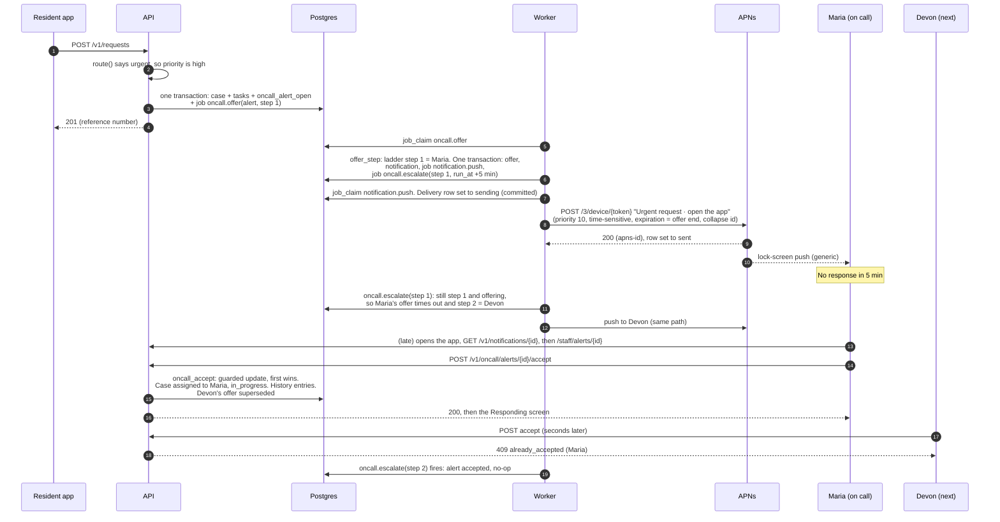
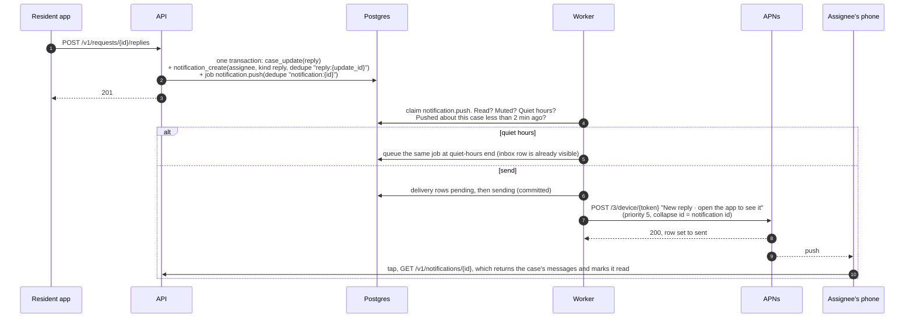

# On-call and push notifications: design

**Status:** proposal for team review · **Date:** 2026-11-21 · Step 2 of
`docs/app-flow.md` ("Coordinate responses").

Urgent work reaches whoever is on call, with Accept / Pass and escalation.
Everyone gets an in-app inbox, and push is a nudge toward it. Nothing here is
built yet. The doc builds on the job queue (ADR 0009), the layering
(ADR 0007, `api/README.md`) and the mobile service modules (ADR 0008).

**In one paragraph.** On-call is a **schedule of shifts** that a **toggle**
can override. It is org-wide, not per service. Every alert is a row in an
**inbox** (`app.notifications`), and that row is the source of truth. A push
is one job per notification, sent **straight to Apple (APNs)** with no Expo
service or EAS in between, and its lock-screen text is always generic. An
urgent, unassigned case opens an **alert**. The alert **offers** the case to the on-call worker for 5 minutes,
then to the next person on call, then to every admin. The first Accept wins
and assigns the case. Every offer, pass, timeout and acceptance is kept, both
for audit and for response-time metrics.

---

## 1. Decisions

### D1. The on-call model: shifts, with a toggle as an override

| Option | For | Against |
|---|---|---|
| A toggle only | Trivial to build | Nobody knows who's on tonight or who's next. Escalation has no "next". People forget to switch off |
| A rotation (weekly, PagerDuty style) | Fair, predictable | Too rigid for a small team with changing shifts. Swaps are a feature of their own |
| **Shifts, with the toggle as an override** ✅ | Matches Figma A3 (day, evening and overnight rows), Today ("Until 11 PM · Devon is next in line") and Me ("On call · Until 11 PM"). "Next" falls out of the data | Admins have to enter shifts (A3 "Edit") |

- **One table, `app.oncall_shifts`.** The toggle doesn't have its own state.
  Switching **on** with no shift running creates an ad-hoc shift from now
  until a chosen end time (the default is the next 11 PM or 7 AM boundary).
  Switching **off** ends the current shift now. Both are logged.
- **Org-wide.** There are 6 workers, and in an emergency the case goes to
  whoever can respond, not to whoever owns the service. A `category` column
  on shifts can be added later without changing the escalation code (see the
  team questions).
- **`rank`:** 1 is primary and 2 is backup. With no backup on shift, "next in
  line" is the person whose shift starts next, within 12 hours.
- **Admins** manage shifts (A3: create, edit, delete, and a week strip).
  Workers see the schedule and toggle themselves. Someone demoted to `member`
  drops out of every ladder, because the ladder query joins on role.

### D2. Who is notified about what

Each event creates **inbox rows** in the same transaction as the change that
caused it. Push is decided per row.

| Event | Who | Inbox | Push | Notes |
|---|---|---|---|---|
| Urgent case needs a responder | The current step's people (D3) | ✅ | ✅ time-sensitive, ignores quiet hours and mutes | Being on call is the opt-in |
| Nobody accepted (the last step ran out) | Every admin | ✅ | ✅ | Also a red banner on Today for all staff |
| Case assigned to you | The new assignee, unless you assigned yourself | ✅ | ✅ | |
| Resident replied | The case's assignee. If there is none: in-app on Queue only, no push | ✅ | ✅ | Replies to an urgent unassigned case: the open alert already covers it |
| Staff sent a public message or changed status | The requester, **if they have an account** | ✅ (shown on the request) | ✅ generic | Signed-out residents: see D5 |
| Task due in 30 min | The task's owner (its assignee, otherwise the case's assignee) | ✅ | ✅ | Matches S7 "Task due in 30 min" |
| Referral status changed by someone else | The case's assignee | ✅ | ❌ in-app only | S7 "Referral accepted" |
| Notes, priority or category changes | — | ❌ | ❌ | Already in the case history |

Push is held back when the row is already read by the time the job runs (the
person was in the app). Non-urgent kinds are also held back when the same
person was pushed about the same case less than 2 minutes ago (coalescing).
Urgent kinds are never coalesced or capped. The inbox always gets the row.

*Considered:* database triggers on `case_updates` that create notifications.
Rejected: it hides behaviour in SQL, couples domains there, and can't see who
acted. Instead, services call `NotificationService.notify` explicitly, in the
same transaction as the change.

### D3. Escalation for urgent cases

**What pages.** A case pages when it is **open, unassigned, and its priority
is `high` or `critical`**. That is one function,
`pages_on_call(case)`, in `models/case_enums.py`, next to `CasePriority`.
Today the router's `urgent` flag already maps to `high`
(`services/case.py`), so this covers the AI routing. `task.py`'s `IMMEDIATE`
categories keep shortening task due times but do **not** page on their own.
A missing person reported three weeks later isn't a 3 a.m. page.

Every entry point that can make a case match opens an alert in the same
transaction as the case write:

| Entry point | Where |
|---|---|
| Resident request, signed in or with an access code | `CaseService.submit_request` / `submit_anonymous_request` (via `create_request`). Today that is several separate writes; it becomes one `executor.transaction()` |
| Staff opens a case | `POST /v1/cases` |
| A Phantom record is confirmed into a case | `POST /v1/records/{id}/confirm`. Today it assigns the case to the record's author (`services/record.py`), so it doesn't page; the check is there in case that changes |
| Priority raised to high or critical while unassigned | `PATCH /v1/cases/{id}` (`CaseService.update`) |
| Voice call (Ava) | **Only when Ava marks the request `urgent`** (`POST /v1/voice/requests`, `urgency: "urgent"`): needs someone today, nobody in danger now. It goes in at `high`, so `_submit` opens the alert like any other. Routine requests don't page, and the `emergency` tier still ends in `redirect_911` (`services/voice.py`) and never becomes a case. `APP__VOICE__URGENT_PAGES_ON_CALL=false` turns this off. *Changed 2026-11-21: this row used to say "Never"; it needs the team's OK before the demo.* |

A **sweeper** in the worker's upkeep opens alerts for any matching case from
the last 24 h that has none. It is a safety net for a missed code path.

**The ladder.** It is worked out at each step, and every offer is recorded:

1. **Primary:** everyone on a rank-1 shift now.
2. **Next:** everyone on a rank-2 shift now. If there is none, whoever's shift
   starts next (Today's "Devon is next in line").
3. **Fallback:** every admin, plus workers who switched on "Urgent alerts when
   off call" (see the Staff Me row in section 5).

A step with nobody new in it is skipped at once. Each step lasts
`APP__ONCALL__OFFER_SECONDS` (default **300**, as in A3 and the flow 3
countdown "4:32"). When the last step runs out, the alert becomes
`unanswered`: admins are paged again every 10 minutes, at most 3 times (job
`oncall.remind`, key `alert:{id}:remind:{n}`; each reminder is a new
notification row, so it gets its own delivery). Meanwhile Today shows "Nobody has accepted #1048" to all staff until someone does. Who
covers 3 a.m. for real is a team question.

**Accept** (`app.oncall_accept`, one statement guarded on
`status IN ('offering', 'unanswered')`; the first one wins):

- The alert becomes `accepted` (who, when). That offer is `accepted`, and the
  other pending offers become `superseded`.
- The case gets `assigned_worker_id` set to the acceptor, and moves from
  `new` to `in_progress`. Two history entries are written: an `assignment`,
  and an internal `alert` entry ("Accepted on call after 2:10, step 1").
  Unassigned tasks follow the case, as they already do.
- **Any staff member** may accept while the alert is open, including people
  whose offer timed out. Getting someone there matters more than the order.
  A second accept gets **409 `already_accepted`** with the name of whoever
  took it.
- The others' inbox rows show "Taken by Maria", read live from the alert. No
  extra push is sent.

*Considered:* broadcasting to every staff member at once. That is faster to a
first accept, but it pages everyone for everything and blurs who is
responsible. Sequential offers match A3 and flow 3, and the fallback step is
the broadcast. Allowing only the person currently offered to accept was also
rejected: a late accept from someone who timed out is still help.

**Pass** records the outcome and an optional reason (`busy`, `too_far`,
`not_safe_alone`) for metrics. When every pending offer in the current step
has passed, the same stored function moves the alert to the next step at
once. The step's timer job then finds the step changed and does nothing.

**Other ways an alert ends:** someone assigns the case by hand (`resolved`
through assignment), or the case is resolved or closed (`cancelled`).
`CaseService.update` calls `OncallService.resolve_for_case`.

**After accepting** (flow 3, screen 3, "Responding"):

- Accepting means en route.
- **I've arrived** sets `arrived_at` and writes a history entry.
- Staff see "Responding · accepted 6 min ago" on the case and on Today.
- **No live location is shared.** The "1.2 mi away" figure is worked out on
  the device from its own location and the case's coordinates, and is never
  sent to the server.

**911.** We are not an emergency service (`docs/voice/README.md`).

- The Respond screen opens with "If anyone may be hurt or armed, call 911
  first" and a **Call 911** button. That button dials only in production
  builds (`lib/phone.ts`).
- The app never calls 911 on its own.
- The resident side keeps "Call 911 first if you're in danger" (Home).
- Paging on-call doesn't replace that advice and is never described to
  residents as a dispatch.

### D4. Delivery: straight to Apple (APNs)

| Option | For | Against |
|---|---|---|
| **APNs directly** ✅ | Only Apple sees a push (and Google, once Android lands). No Expo account or project, no EAS. One HTTP/2 POST per device, answered on the spot, so there are no receipts to poll | We sign our own JWTs and hold one more secret (the `.p8` key). Android needs a second adapter later |
| Expo Push Service | One API for iOS and Android. Expo holds the APNs and FCM credentials | Needs an Expo account and project, and EAS to hold the credentials. Expo sees every push's metadata (when, which device, which app). One more third party in the path of a domestic-violence app. Delivery is only known by polling receipts later |

`adapters/push.py` follows `adapters/storage.py`: a `PushProvider` protocol
with `ApnsPushProvider` and `FakePushProvider`, chosen by
`APP__PUSH__PROVIDER` (`apns` | `fake`). Android comes later as
`FcmPushProvider` (FCM HTTP v1) behind the same protocol, picked by the
device's `platform`.

**Tokens (`app.push_devices`):**

- **Register.** After sign-in, and once permission is granted, the app calls
  `getDevicePushTokenAsync()` from `expo-notifications` (the library has no
  server dependency) and gets the raw APNs device token. It sends
  `PUT /v1/me/devices` `{token, platform, environment, app_version}` on every
  launch. `environment` is the APNs host the token belongs to: `sandbox` for
  dev builds, `production` for TestFlight and the App Store (the app sends
  `__DEV__ ? 'sandbox' : 'production'`; a Release build signed for
  development would get this wrong and show up as `BadDeviceToken`). A
  rotated token arrives through
  `addPushTokenListener` and is sent the same way. The upsert is by token: a
  phone that changes hands moves to the new user.
- **Several devices** per user are fine, up to 10; the oldest is dropped.
- **Sign-out** calls `DELETE /v1/me/devices/{token}` *before* the access token
  is cleared. If that fails (the phone is offline), the next sign-in on that
  phone moves the token over. Meanwhile the payload is generic anyway, and
  opening it fetches with the current session, so the old account's
  notification returns 404 and nothing shows.
- **Stale tokens.** APNs answers `Unregistered` or `BadDeviceToken` (see
  Responses), and the device is disabled. A disabled device comes back only
  when it registers with a different token or environment. Devices not seen
  for 60 days are pruned by upkeep.

**Sending (`ApnsPushProvider`):**

- One long-lived `httpx.AsyncClient(http2=True)` per worker (the `httpx[http2]`
  extra). APNs accepts only HTTP/2, and one connection multiplexes every
  request.
- `POST https://api.push.apple.com/3/device/<token>` for `production`
  devices, `https://api.sandbox.push.apple.com/3/device/<token>` for
  `sandbox`. One request per device; APNs has no batch send.
- **Auth: a provider token.** An ES256 JWT with header `alg: ES256`,
  `kid: <key ID>` and claims `iss: <team ID>`, `iat: <now>`, signed with the
  team's `.p8` auth key and sent as `authorization: bearer <jwt>`. It is
  cached and reused: Apple says refresh it no more than once every 20 minutes
  and no less than once every 60, and rejects one older than an hour. We
  renew at 50 minutes. Renewing too often gets 429
  `TooManyProviderTokenUpdates`.
- `apns-topic` is the bundle ID. The staging variant (`app.config.ts`) has
  its own bundle ID, so each deployment sets its own topic.
- **Secrets:** `APP__PUSH__APNS_KEY` (the `.p8` contents),
  `APP__PUSH__APNS_KEY_ID`, `APP__PUSH__APNS_TEAM_ID`, `APP__PUSH__APNS_TOPIC`.
  Deployments read them from Vault through External Secrets, like the rest.
  Locally they go in `api/.env` (gitignored), copied from Vault.

**Each request:**

| Header | Value |
|---|---|
| `apns-push-type` | `alert` |
| `apns-priority` | `10` for urgent kinds (`urgent_offer`, `urgent_unanswered`), `5` otherwise |
| `apns-expiration` | Urgent offer: the offer's `expires_at` (UNIX seconds), so a page that arrives after it moved on is dropped. Others: now + 24 h |
| `apns-collapse-id` | The notification id (a UUID is 36 bytes; Apple's limit is 64) |
| `apns-topic` | The bundle ID |

```json
{
  "aps": {
    "alert": { "title": "Urgent request", "body": "You're on call. Open the app to respond." },
    "sound": "default",
    "badge": 3,
    "interruption-level": "time-sensitive",
    "thread-id": "urgent"
  },
  "n": "<notification id>"
}
```

`interruption-level` is `time-sensitive` for urgent offers and `active`
otherwise. `thread-id` groups by kind (`urgent` or `updates`), never by
case. The fixed strings per kind are in D5.

**Responses.** APNs answers each request on the spot, so there is no
receipts job. `sent` means APNs accepted it; whether it reached the phone
isn't knowable, because APNs has no delivery receipt.

| Status and reason | Delivery row | Device | Job |
|---|---|---|---|
| 200 | `sent`, with the returned `apns-id` | | |
| 410 `Unregistered` or `ExpiredToken` | `failed` | Disabled | |
| 400 `BadDeviceToken` | `failed` | Disabled. This is also what a token sent to the wrong environment gets (sandbox token to production, or the reverse) | |
| 400 `DeviceTokenNotForTopic` | `failed` | Disabled (a token from another app variant) | |
| Other 400s, 413 (`BadCollapseId`, `PayloadTooLarge`, ...) | `failed` | | Not retried; logged at ERROR, because it's our bug |
| 403 `ExpiredProviderToken`, `InvalidProviderToken` | Back to `pending` | | Renew the JWT and retry once. If it's still 403, log ERROR (the key is broken or revoked) and fail with backoff |
| Other 403s (`BadEnvironmentKeyIdInToken`, `Forbidden`) | Back to `pending` | | ERROR (key configuration), fail with backoff |
| 429 `TooManyRequests`, 500, 503, a network error or timeout | Back to `pending` | | Fail and retry with the queue's backoff |
| 429 `TooManyProviderTokenUpdates` | Back to `pending` | | ERROR (the JWT cache is churning), retry |

Apple suggests waiting 15 minutes before retrying a 5xx. We retry sooner
with the queue's backoff, because an urgent page can't wait 15 minutes, and
`apns-expiration` already bounds how late it can land.

**Delivery job (`notification.push`, one per notification, dedupe key
`notification:{id}`):**

1. `run` loads the notification, the recipient's preferences and their active
   devices. It skips the push if the row is read, the kind is muted, or the
   person has no devices. During quiet hours (non-urgent only) it sends
   nothing. Instead, `finish` queues a deferred job under its own key,
   `notification:{id}:after-quiet`. The live job still holds
   `notification:{id}`, so reusing that key would be a silent no-op. Better
   still, `notify` gives the first job a `run_at` at the end of quiet hours
   to begin with.
2. It inserts or claims one `app.notification_deliveries` row per (notification,
   device), unique on both. Each row moves `pending` → `sending`, and that
   change is committed **before** the HTTP call. This stage breaks the
   "`run` only reads" rule in `services/pipeline.py`, on purpose: the
   provider call is the side effect, so the claim must be durable before it.
3. One POST per device, all on the one HTTP/2 connection. Each answer is
   recorded as it comes: `sent` with the `apns-id`, or `failed` with the
   reason (the Responses table).
4. **Retries.** A retryable answer (429, 5xx, a network error) puts that row
   back to `pending`, and the job fails and retries with the queue's
   backoff. A permanent one is `failed` for good; the inbox still has the
   row.
5. **No double pushes.** APNs has no idempotency key. The decision is: at
   most one send per (notification, device) in normal operation, plus visual
   de-duplication for the one gap. A row still in `sending` when a retry
   runs (a crash between send and commit) **is resent once**: losing an
   urgent page is worse than repeating it. That repeat carries the same
   `apns-collapse-id` (the notification id), so it **replaces** the shown
   notification instead of stacking, and the person sees one. (FCM's
   collapse key does the same for Android later.)
6. **Expiry.** An urgent offer's `apns-expiration` is the offer's
   `expires_at`, so a page that arrives after it moved on is dropped in
   transit.

**Rate limits.** Our volume (tens a day) is far below anything APNs
throttles; its 429 `TooManyRequests` is about too many pushes to one device.
Non-urgent pushes are capped at 20 an hour per person; anything beyond that
stays inbox-only.

**Preferences (`app.notification_preferences`, one row per user, defaults
when absent):** `push_enabled`, `muted_kinds text[]`, `quiet_start`,
`quiet_end`, `urgent_when_off_call`. Quiet hours use `users.timezone`; while
that is still the default `UTC`, they use the org's zone
(`APP__ONCALL__TIMEZONE`, `America/Chicago`). The app already sends the
phone's IANA zone to `PATCH /v1/me` after sign-in (`lib/auth.tsx`). Shift times are stored as `timestamptz`
and shown in the org's zone.

**Platform settings:**

- **iOS:** urgent offers use `interruption-level: time-sensitive` (an
  entitlement, so it works through Focus); everything else is `active`.
- **Android (later, with FCM):** an `urgent` channel (high importance, sound)
  and an `updates` channel (default importance).
- **Critical alerts** (which bypass mute) need Apple's approval: not now.

### D5. What a push may say

Assume someone unsafe can see the phone. **No push contains anything about a
person, place or situation**: no case title, number, name, category or
message text. The device can't tell its owner from someone else, and the text
also passes through Apple (and Google, once Android lands). No one else sees
it.

| Kind | Title | Body | Extras |
|---|---|---|---|
| Urgent offer (staff) | Urgent request | You're on call. Open the app to respond. | time-sensitive, sound, priority 10, `apns-expiration` = the offer's end |
| Nobody accepted (admins) | Urgent request waiting | Nobody has accepted yet. | time-sensitive, priority 10 |
| Assignment / reply / task due (staff) | New assignment / New reply / Task due soon | Open the app to see it. | badge = unread count |
| Anything to a resident | *(none)* | You have a new update. | **no sound by default**, no badge |

- Besides `aps`, the payload carries only `"n": "<notification id>"`. On a tap, the app
  (signed in) calls `GET /v1/notifications/{id}`, which returns the route
  (`/staff/alerts/…`, `/staff/cases/…` or `/help/request/…`) and marks the row
  read. The details are fetched there, under auth.
- *Considered:* a short case summary on the staff lock screen, as in flow 3.
  Rejected: staff phones can be seen too, and the text passes through Apple
  (and Google later).
- **R5's "Hide message text on lock screen" switch is dropped.** R6 promises
  "Message text never shows on your lock screen", and D5 makes that always
  true, so a switch would only suggest it could be turned off.
- **Signed-out residents** (access code, no account) get **no push** in v1.
  Push needs a token tied to someone, and tying a token to a request through
  its code would let anyone holding the code register a phone. Instead, the
  app remembers the last update it saw for each saved request
  (`lib/savedRequests.ts`), checks on open and when it returns to the
  foreground, and shows an unread dot on Requests and on the request.
  Requests submitted signed out also show "Sign in to be notified when we
  reply". *Considered:* a code-bound token (`POST
  /v1/public/requests/{number}/devices` with the code). Deferred: the code
  then becomes a subscription anyone who sees it can take. Pushing to
  code-holders is a team question.
- **The app's name** ("Hacksgiving", later perhaps ComForce) still shows on
  every push. A neutral name and icon is a team question.

### D6. The inbox is the source of truth; push is a nudge

- `app.notifications` holds **references, not text**: `kind`, `case_id`,
  `case_update_id`, `task_id`, `alert_id`, `actor_id`.
  `app.notification_list` builds the title and body when it is read, from the
  current data and limited to what the reader may see (residents go through
  the `request_*` public columns). So nothing sensitive is copied, an edit or
  deletion shows up everywhere, and "Taken by Maria" is live. *Considered:*
  copying the rendered text into the row (simpler reads). Rejected: it
  duplicates case content into a second table with its own retention and
  access rules, and goes stale.
- **Read state:** `read_at` per row.
  - **Mark read** (S7) is `POST /v1/notifications/read-all`.
  - Opening a case marks that person's rows for the case read
    (`app.notification_read_for_case`).
  - Tapping a push marks its row read.
- **Unread count** (the badge and the bell on Today):
  `GET /v1/notifications/unread-count`. It refetches on focus, every 30 s on
  Today while on call, and when a push arrives in the foreground (which
  invalidates the `notifications` queries).
- **Residents** have no inbox screen (none in Figma). Their rows show as
  unread dots on Requests and on the request thread (R1, R2).
- **Retention:** 90 days for notifications and 30 days for deliveries.
  Alerts and offers are kept: they are the audit trail and the metrics.
- **Overlap to clean up:** the resident `/alerts` screen has "Your ComForce
  notifications" (voice follow-ups, `GET /v1/voice/follow-ups`). Once the
  inbox exists, voice follow-ups should create inbox rows, and that section
  should go. **The inbox survives.** The public safety-alert list on
  `/alerts` stays; it is a different thing.

---

## 2. Data model

New migrations take the next free number on `origin/main` **when they are
written**. As of `9e34c96` the latest is `0012_voice_referral_history`, so the
first is **0013**. One revision per phase (section 7), so each phase ships on
its own. All SQL is in `app.<domain>_<verb>` functions (ADR 0007).

```sql
-- oncall
app.oncall_shifts (
  id uuid pk, user_id uuid not null → users,
  starts_at timestamptz not null, ends_at timestamptz not null check (ends_at > starts_at),
  rank smallint not null default 1 check (rank in (1, 2)),
  source text not null check (source in ('schedule', 'toggle')),
  created_by uuid → users, created_at, updated_at
)  -- no overlapping shifts per user (checked in oncall_shift_save)
   -- index (starts_at, ends_at)

app.oncall_alerts (
  id uuid pk, case_id uuid not null → cases,
  status text check (status in ('offering', 'unanswered', 'accepted', 'resolved', 'cancelled')),
  step smallint not null default 1, step_expires_at timestamptz,
  accepted_by uuid → users, accepted_at, arrived_at,
  reminders_sent smallint default 0, created_at, closed_at
)  -- unique (case_id) where status in ('offering', 'unanswered'): one open alert per case

app.oncall_offers (
  id uuid pk, alert_id → oncall_alerts, user_id → users, step smallint,
  offered_at, expires_at,
  outcome text check (outcome in ('pending', 'accepted', 'passed', 'timed_out', 'superseded')),
  pass_reason text check (pass_reason in ('busy', 'too_far', 'not_safe_alone')), responded_at
)  -- unique (alert_id, user_id, step)

-- notification
app.notifications (
  id uuid pk, user_id → users,
  kind text check (kind in ('urgent_offer', 'urgent_unanswered', 'assignment', 'reply',
                            'request_update', 'task_due', 'referral_update')),
  case_id, case_update_id, task_id, alert_id, actor_id,   -- references only, no text
  dedupe_key text not null, created_at, read_at
)  -- unique (user_id, dedupe_key): the same event never makes two rows
   -- index (user_id, created_at desc), and (user_id) where read_at is null

app.push_devices (
  id uuid pk, token text unique not null, user_id → users,
  platform text check (platform in ('ios', 'android')), app_version text,
  environment text check (environment in ('sandbox', 'production')),   -- APNs host; null for android
  created_at, last_seen_at, disabled_at, disabled_reason text
)

app.notification_deliveries (
  id uuid pk, notification_id → notifications, device_id → push_devices,
  status text check (status in ('pending', 'sending', 'sent', 'failed', 'skipped')),
                                     -- sent = accepted by APNs; delivery to the phone isn't knowable
  apns_id text, error_code text,     -- APNs's reason string only, never content
  attempts smallint, updated_at
)  -- unique (notification_id, device_id)

app.notification_preferences (
  user_id pk → users, push_enabled bool default true, muted_kinds text[] default '{}',
  quiet_start time, quiet_end time, urgent_when_off_call bool default false, updated_at
)
```

In phase 3's migration, `case_updates.update_type` gains **`alert`** (internal): offered, passed,
accepted and arrived, so the case history tells the story. The detail stays
in `oncall_offers`, because finished jobs are pruned.

**Stored functions:**

- **oncall:**
  - Shifts and the toggle: `oncall_now`, `oncall_shift_list`,
    `oncall_shift_save`, `oncall_shift_delete`, `oncall_toggle`.
  - Alerts: `oncall_ladder`, `oncall_alert_open`, `oncall_alert_get`,
    `oncall_alert_list`, `oncall_offer_step`, `oncall_escalate`.
  - Responses: `oncall_accept`, `oncall_pass`, `oncall_arrived`.
  - Upkeep and metrics: `oncall_resolve_for_case`, `oncall_alert_sweep`,
    `oncall_stats`.
- **notification:**
  - Inbox: `notification_create`, `notification_list`, `notification_get`,
    `notification_unread_count`, `notification_read`,
    `notification_read_all`, `notification_read_for_case`.
  - Devices: `notification_device_register`,
    `notification_device_remove`, `notification_device_disable`.
  - Preferences: `notification_preferences_get`,
    `notification_preferences_save`.
  - Delivery: `notification_delivery_claim`,
    `notification_delivery_record`, `notification_stats`,
    `notification_prune`.

---

## 3. Sequence diagrams

### An urgent case, from creation to acceptance



### A resident reply notifies the assignee



---

## 4. API and jobs

**`oncall`** (`routers/oncall.py` → `services/oncall.py` → `databridge/oncall.py`):

| Route | Who | What |
|---|---|---|
| `GET /v1/oncall/now` | staff | Who's on now, until when, who's next, and whether I'm on. Feeds the Today card and Me |
| `POST /v1/oncall/me` `{on, until?}` | staff | The toggle (an ad-hoc shift, or ends mine). Returns a warning when I have no active push device |
| `GET /v1/oncall/shifts?from=&to=` | staff | A3 |
| `POST/PATCH/DELETE /v1/oncall/shifts[/{id}]` | admin | A3 "Edit" |
| `GET /v1/oncall/alerts?open_only=` | staff | Open alerts, for the Today banner |
| `GET /v1/oncall/alerts/{id}` | staff | The Respond screen: case summary, coordinates, my offer, `expires_at`, next person |
| `POST /v1/oncall/alerts/{id}/accept`, `/pass` `{reason?}`, `/arrived` | staff | 409 `already_accepted` / `alert_closed` |
| `GET /v1/oncall/stats?from=&to=` | admin | Response-time metrics for Insights |

**`notification`** (`routers/notification.py` → `services/notification.py` →
`databridge/notification.py`, plus `adapters/push.py`):

| Route | Who | What |
|---|---|---|
| `GET /v1/notifications?before=&limit=` | anyone signed in | The inbox (S7), rendered for the reader's role |
| `GET /v1/notifications/unread-count` | anyone | Badge and bell |
| `GET /v1/notifications/{id}` | owner | `{route, ...}` for a tapped push; marks it read |
| `POST /v1/notifications/{id}/read`, `POST /v1/notifications/read-all` | owner | |
| `PUT /v1/me/devices` `{token, platform, environment, app_version}`, `DELETE /v1/me/devices/{token}` | anyone | Token lifecycle |
| `GET/PATCH /v1/me/notification-preferences` | anyone | R5, Staff Me |
| `POST /v1/notifications/test` | anyone, 3 per 10 min | "Send me a test", for checking a build |
| `GET /v1/notifications/stats` | admin | Deliveries by status (24 h), disabled devices, APNs errors by reason |

Other domains call `NotificationService.notify(tx, …)` and
`OncallService.open_for_case(tx, case)` inside their own transaction (the
outbox pattern, as in ADR 0009). `CaseService` doesn't write notification
rows itself.

**Job kinds** (all on the existing runner):

| Kind | Dedupe key | Does |
|---|---|---|
| `oncall.offer` | `alert:{id}:offer:{step}` | Works out the step, creates offers and notifications, queues `oncall.escalate` |
| `oncall.escalate` | `alert:{id}:escalate:{step}` | At `step_expires_at`: no-op unless still `offering` at that step. Then times out the offers and moves on (or marks the alert `unanswered` and starts reminders) |
| `oncall.remind` | `alert:{id}:remind:{n}` | For an `unanswered` alert: a new notification for each admin, then queues the next reminder (n ≤ 3). No-op once the alert is accepted or closed |
| `notification.push` | `notification:{id}` (deferred: `notification:{id}:after-quiet`) | D4 steps 1–6 |
| `task.remind` | `task:{id}:remind:{due_at}` | Queued when a task is created or its due time or owner changes, with `run_at = due_at − 30 min`. No-op if the task is done or its due time changed |

Stages live next to their domain (`services/oncall_jobs.py`,
`services/notification_jobs.py`) with the same `run`/`finish`/`on_dead`
contract as `services/pipeline.py`. **The worker must start these without
`APP__OPENAI__API_KEY`.** Today the worker refuses to start without it, which
would stop escalation. Phantom's stages become optional; on-call and
notification stages always run. Missing APNs secrets don't stop the worker
either: the push stage logs ERROR and marks rows `failed`, and the inbox and
escalation carry on. Upkeep gains `oncall_alert_sweep`,
`notification_prune` and the device prune.

---

## 5. Screens, mapped to Figma

| Figma frame | Route (new unless noted) | Mobile service | Where Figma and this design disagree |
|---|---|---|---|
| **Staff Today** (26:122), "You're on call" card | `/staff` (have) | `oncall.ts` (`useOncallNow`, `useToggleOncall`) | Matches. Adds the "Nobody has accepted" banner and the bell with the unread count |
| **Staff Me** (26:221), Shift: On call / Urgent alerts | `/staff/me` (have) | `oncall.ts`, `notifications.ts` (preferences) | **"Urgent alerts" can be off while On call is on in the mockup.** Here, on call always gets urgent offers. The switch means "also alert me when I'm **off** call" (`urgent_when_off_call`, the fallback pool) and is disabled while you're on call |
| **A3 On-call schedule** (33:2614), not in the brief | `/staff/oncall` | `oncall.ts` | Matches: 5 min to the next person, then every admin. Adds "workers who opted in" to step 3, plus reminders when nobody accepts. Its "after 10 min, every admin" assumes each step is 5 min. `app-flow.md` still lists the timing as open (team question) |
| **S7 Notifications** (33:2390), Accept / Pass | `/staff/notifications` | `notifications.ts`, `oncall.ts` | Matches: urgent first, then today, then earlier. S7's urgent row says "it goes to Devon"; we show the next person from `oncall/now` |
| Mockups flow 3, screen 1: **lock-screen push** | (system) | `lib/push.ts` | **The biggest conflict.** The mockup shows "Conflict escalating near N 27th & W Wells, two adults arguing…" and "Confirm ride to Harbor House". Both break D5. The lock screen shows only "Urgent request · You're on call. Open the app to respond." The Figma frame should change |
| Mockups flow 3, screen 2: **Respond** | `/staff/alerts/[id]` | `oncall.ts`, `deviceLocation.ts` | Matches: map, what we know, countdown, "Accept and head there", "Pass to next on call". Distance is worked out on the device. Adds a 911 line at the top. No "What we know" until the app is open and signed in |
| Mockups flow 3, screen 3: **Responding** | `/staff/alerts/[id]` (accepted state) | `oncall.ts` | "Staff can see you're en route" means status only. **No ETA is shared** (no location leaves the phone), so the ETA shows only to the responder |
| **R6 Notification ask** (32:1895) | `/help/notifications` (modal), after the first request is sent **while signed in** | `lib/push.ts`, `notifications.ts` | Matches, and its "never on your lock screen" promise is D5. Not shown to signed-out residents (no push). They see "Sign in to be notified" instead |
| **R5 Me (resident)** (32:1787) | `/(main)/me` (have) | `notifications.ts` (preferences) | "Replies and updates" maps to `request_update`. **"Hide message text on lock screen" is dropped** (always hidden, per D5 and R6). **"Community alerts"** (safety-alert push) is out of scope; leave it off or remove it (team question) |

Mobile pieces:

- **`services/notifications.ts`:** inbox, unread count, read, devices and
  preferences.
- **`services/oncall.ts`:** now, toggle, shifts, alerts, accept, pass and
  arrived. Both follow ADR 0008 (TanStack Query, one module per domain,
  types from `openapi.json`).
- **`lib/push.ts`:**
  - Permission, token registration (`getDevicePushTokenAsync()` plus the
    build's APNs environment), the Android channels once FCM lands, and a
    foreground handler: urgent offers show a banner in the app, other kinds only
    refresh the badge.
  - The tap handler: `GET /v1/notifications/{id}`, then `router.push`.
  - Under Expo Go (`Constants.executionEnvironment === 'storeClient'`) it
    does nothing, and the inbox still works.

---

## 6. Builds, testing, operations

### What build push needs

Per Expo's docs, since SDK 53 **Expo Go doesn't support push**, and a token
from Expo Go would belong to Expo's app, not ours. So we need our own
**development build** (`expo-dev-client`). **No EAS:** no Expo account, no
cloud builds; we build on the team's Mac.

1. `npx expo install expo-notifications expo-dev-client`. In `app.json`: the
   `expo-notifications` plugin, the iOS entitlements (`aps-environment`, and
   `com.apple.developer.usernotifications.time-sensitive` for urgent offers),
   and `android.package` (it doesn't exist yet), so the Android ID is fixed
   before FCM.
2. `npx expo prebuild` generates `ios/` (and `android/`). Open the
   workspace in Xcode on the team's Mac with automatic signing under the
   team's account; it adds the Push Notifications and Time Sensitive
   Notifications capabilities to the App ID. Re-run prebuild after any
   `app.json` or native dependency change.
3. **Dev builds** run from Xcode on a plugged-in phone (automatic signing
   registers it). They are signed for development, so their tokens belong to
   the **sandbox**.
4. **TestFlight:** Product → Archive, then upload from the Organizer, or
   export and upload with Transporter. These builds use the **production**
   host.
5. **The APNs auth key (once).** An account holder creates a key with APNs
   enabled in the Apple developer portal (Certificates, Identifiers &
   Profiles → Keys), downloads the `.p8` (Apple offers the download only
   once) and notes the key ID and the team ID. They go into Vault (D4,
   Sending). The Apple Developer account already exists. The staging variant
   (`app.config.ts`) is a separate bundle ID with its own topic and needs
   the same capabilities.
6. A plus: a dev build signs in with the native `hacksgiving://auth`
   callback instead of the per-IP `exp://` entries. That callback is in
   `native_callback_urls`, but only on the "Hacksgiving Mobile" Auth0 client,
   not "(dev)". Check which client ID the dev build uses, and add the
   callback to the dev client if needed.

**Testing on your own phone:**

- Install a dev build once: plug the phone into the team's Mac and run it
  from Xcode. (A TestFlight build can't load your local Metro and uses the
  production host.)
- Run `scripts/dev.sh` as today; the dev build connects to your Metro the way
  Expo Go did.
- Locally, set `APP__PUSH__PROVIDER=apns` and the four `APP__PUSH__APNS_*`
  values in `api/.env` (from Vault). The dev build registers as `sandbox`, so
  your API sends to the sandbox host. Without them, `fake` logs the pushes.
- **Me → Send me a test** checks the whole path.
- For escalation, set `APP__ONCALL__OFFER_SECONDS=60`, use two phones or two
  accounts, put one on call, and submit an urgent request from a third
  account.
- Until push lands (phase 1), everything works in Expo Go through the inbox.

### Automated tests

- **`FakePushProvider`** records requests and can be scripted to return
  APNs answers: 410 `Unregistered`, 400 `BadDeviceToken`, 403
  `ExpiredProviderToken`, 429, 5xx, a timeout, or a crash after sending.
- **`ApnsPushProvider` unit tests** (no network, an `httpx` mock transport):
  the host by environment, the headers per kind, a collapse id within 64
  bytes, and the JWT cache (reused under 20 minutes, renewed before 60,
  renewed once on a 403).
- **Unit tests** (`tests/unit`, fakes):
  - The ladder (primary, backup, next shift, fallback; empty steps skipped).
  - `pages_on_call`.
  - Quiet hours across time zones and DST.
  - Coalescing and caps.
  - **A payload test over every kind, which asserts the push contains only
    fixed strings and the notification id**, so no case data can leak.
- **Integration tests** (`tests/integration`, real Postgres, as in
  `test_jobs.py`):
  - Two concurrent accepts: one wins and the other gets 409.
  - The timer firing after an accept or a pass does nothing.
  - Every offer in a step passed escalates at once.
  - An unanswered alert sends reminders, at most 3.
  - Resolving or assigning a case closes its alert.
  - The sweeper opens a missed alert.
  - Queueing the same notification push twice makes one job.
  - A retry after a crash in `sending` resends at most once per device,
    with the same `apns-collapse-id`. A clean retry after 429/5xx sends only
    the rows still `pending`.
  - `Unregistered` and `BadDeviceToken` disable the device; a 403 leaves it
    alone.
  - A token moves to a new user, and sign-out removes it.
  - Isolation: residents never see staff notifications or another person's,
    and `notification_list` never returns internal notes to a resident.
  - The downgrade lists (`test_migrations.py`).
- **App tests** (`npx jest`): the tap routing, Expo Go doing nothing, and the
  Respond countdown.

### Failure modes and how we'd know

| What breaks | Effect | How we know |
|---|---|---|
| The worker is down (or crash-looping, e.g. the OpenAI key) | No pushes, no escalation | k8s liveness on `:8090`. The `jobs/stats` backlog. Inbox rows still appear (they're written by the API) |
| Nobody on call | Step 1 is empty, so it goes straight to next or fallback | `oncall_now` empty: the Today card says "Nobody is on call" in red |
| APNs down (5xx, timeouts) | Pushes retry with backoff until `apns-expiration`; the inbox is fine | Rows stuck in `pending`, the `jobs/stats` retry count |
| The APNs key revoked, deleted or mis-set | Every push gets 403 (`InvalidProviderToken`); the inbox is fine | ERROR logs after the one JWT renewal. 403s by reason in `notifications/stats` |
| Sandbox/production mismatch (a build reports the wrong environment) | That device gets 400 `BadDeviceToken` and is disabled | Disabled devices by reason in `notifications/stats`. "Send me a test" shows it at once |
| An on-call person with notifications off or no device | Their step uses up its 5 min | Toggling on warns. Stats show the share of offers with no device |
| Poll latency | Up to about 5 s (idle polling); timers fire within about 5 s of `run_at` | Fine for minutes-long steps. Run 2 worker replicas |
| A dead job | That push is lost; the inbox still has the row | `jobs/stats` dead count |
| An unanswered alert | Nobody responding | Reminders to admins, the Today banner on every staff phone, a WARNING log |

**Metrics** (`oncall_stats`, feeding Insights' "18 min avg"):

- Time to first offer.
- **Time to accept** (alert created → accepted).
- Steps needed.
- Pass rate by reason.
- The share of alerts that went unanswered.
- **Time to arrive** (accepted → arrived).
- Push acceptance rate (APNs 200s; delivery to the phone isn't knowable).

All of it comes from `oncall_alerts` and `oncall_offers`, which are never
pruned.

---

## 7. Phased plan (each slice usable on its own)

1. **On-call + inbox (no push; works in Expo Go).** Migrations 0013 and 0014:
   `oncall_shifts`, `notifications`, `notification_preferences`. Today card,
   Me Shift toggle, A3 (view, admin edit), S7 for assignment, reply,
   task-due (`task.remind`) and referral rows, the unread bell. The worker's
   stages no longer need the OpenAI key. *Done when* a worker toggles on call
   and Today shows it, and an assignment shows on the assignee's S7 with a
   badge.
2. **Push delivery (iOS, no EAS).** `expo-notifications`, prebuild and an
   Xcode dev build, the APNs auth key and its Vault secrets, the
   `push_devices` (with `environment`) and `notification_deliveries`
   migration, `adapters/push.py` with `ApnsPushProvider`, the
   `notification.push` job, R6, resident request-update pushes, "Send me a
   test", `notifications/stats`. *Done when* a reply on a case pushes the
   assignee's phone with generic text, from both a dev build (sandbox) and
   TestFlight (production), and a tap opens the case. Android
   (`FcmPushProvider`) is a later slice.
3. **Urgent escalation.** The `oncall_alerts` and `oncall_offers` migration,
   `pages_on_call` at every entry point (and the transaction refactor of
   `submit`), the offer and escalate jobs, Accept/Pass/Arrived, Respond and
   Responding screens, the Today banner, the sweeper, `oncall_stats` in
   Insights. *Done when* an urgent request pages the on-call phone, moves to
   the next person after the timeout, and an accept assigns the case. All of
   that is covered by integration tests.
4. **Preferences and polish.** Quiet hours, muted kinds, coalescing and caps,
   R5 switches, `urgent_when_off_call`, voice follow-ups moved into the
   inbox, retention and pruning. Optionally: pushes for signed-out residents
   and community alerts, if the team says yes.

---

## 8. Risks

- **Builds become a prerequisite.** Push testing moves from Expo Go to a dev
  build made in Xcode, and with no EAS every build and TestFlight upload
  goes through the team's one Mac. Phase 1 deliberately needs neither.
- **We own the APNs plumbing.** An APNs outage delays pushes (the inbox is
  unaffected). A revoked or lost `.p8` key stops every push until a new one
  is in Vault; only an account holder can make one. A build that reports
  the wrong environment disables its own device on the first push.
- **The worker is now on the critical path for safety.** A crash-loop stops
  escalation. Mitigations: decouple it from OpenAI, run 2 replicas, the Today
  banner, liveness.
- **False confidence.** A page isn't a dispatch. Copy must never tell a
  resident "help is on the way" before an accept, and 911 guidance stays
  first.
- **Alert fatigue.** If `high` pages too often, people will mute it. Watch the
  pass and unanswered rates. Narrowing to `critical` is a one-line change.
- **One person on call overnight.** With no backup and no next shift, an
  alert goes straight to admins. That's a staffing question, not a technical
  one.
- **A shared or lost phone.** The payload is generic and opening requires
  auth, but a phone signed out while offline keeps a token until the next
  sign-in moves it.
- **Third parties:** Apple (and Google, once Android lands) sees the generic
  text and metadata (when, which device). That is acceptable only because D5
  holds; the payload test enforces it.
- **The pooler and polling.** There is no LISTEN/NOTIFY, so latency is about
  5 s. Fine for minutes-long steps.

---

## 9. Questions for the team (product calls)

1. **Who is the fallback at 3 a.m.?** Every admin, as in A3, or a named
   duty manager? And what happens after 3 reminders with no answer?
2. **Timing.** Is 5 minutes per step right (A3 and flow 3 say 5;
   `app-flow.md` lists it as open)? Same for every category?
3. **What pages:** `high` + `critical` (proposed), or only `critical`?
4. **Per-service on-call** (e.g. a DV-trained responder for violence
   prevention)? It's designed to be addable later.
5. **Shift structure:** fixed blocks (7–5, 5–11, 11–7 as in A3) or free-form?
   Are backups (rank 2) used?
6. **Is a resident push silent by default?** (Proposed: yes; a sound at the
   wrong moment can be dangerous.) And quiet hours for residents?
7. **Signed-out residents:** stay with no push, or allow a phone to subscribe
   to one request with its access code? *Decided 2026-11-21: allowed (the
   code already opens the thread; generic text; max 3 phones). See
   `services/request_push.py`.*
8. **App name and icon on the lock screen:** keep "Hacksgiving"/ComForce, or
   a neutral name?
9. **Location:** keep it on-device only (proposed), or share the responder's
   location or ETA with staff while responding, as flow 3's "Staff can see
   you're en route" might mean?
10. **R5 "Community alerts":** build safety-alert pushes, or remove the
    switch? *Decided 2026-11-21: built for serious weather, opt-in and off
    by default (`services/weather_jobs.py`).*
11. **Staff Me "Urgent alerts":** OK to make it the off-call opt-in?

---

## Coverage

| Asked | Where |
|---|---|
| 1 On-call model | D1. Team questions 4, 5 |
| 2 Who is notified about what | D2 |
| 3 Escalation, Accept/Pass, fallback, what accept changes, 911 | D3. Team questions 1–3 |
| 4 Delivery (direct APNs, no EAS), tokens, APNs responses, retries, rate limits, quiet hours, preferences | D4; builds in section 6 |
| 5 Payload privacy, the hide switch, anonymous residents | D5. Team questions 6–8 |
| 6 Inbox as the source of truth | D6 |
| 7 Data model, functions, migration number, API, jobs, screens | Sections 2, 4, 5 |
| 8 Testing (fake provider, integration, own phone) | Section 6 |
| 9 Failure modes, operations, metrics | Section 6 |
| 10 Phased plan | Section 7 |
| Frames: Today card, Staff Me, S7, R6, R5, flow 3 (3 screens), and A3 (not in the brief) | Section 5, each with its disagreements |
